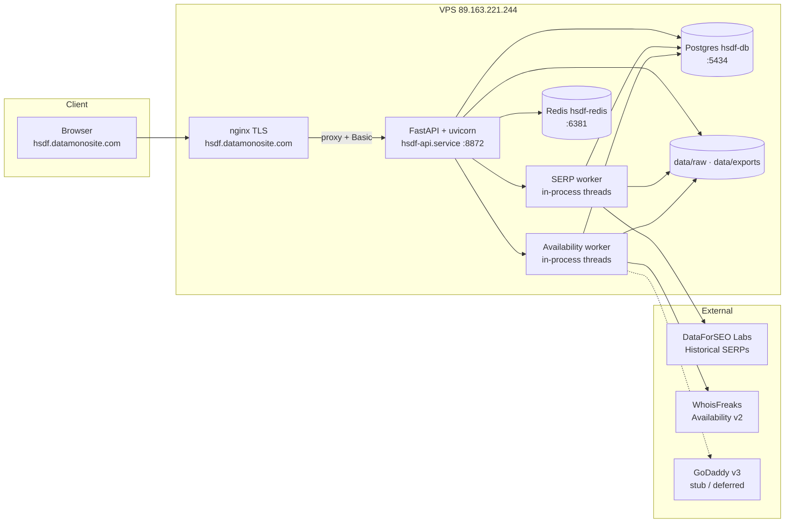
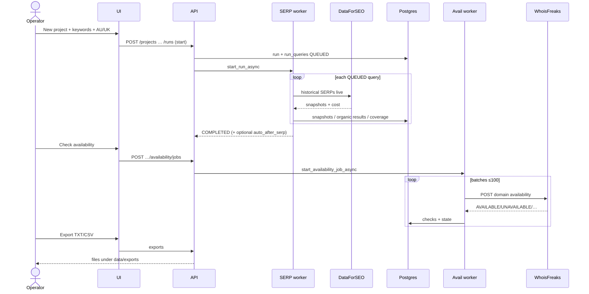

# Architecture — Historical SERP Domain Finder (MVP)

**Дата:** 2026-11-20  
**Scope:** MVP (SERP ≤365d + WhoisFreaks availability + internal UI).  
**Не в scope:** покупка доменов, Phase 2 (глубокая история, Wayback, related KW).

## Обзор

Внутреннее standalone-приложение на том же VPS, что company dashboard, но в **отдельном** дереве `/opt/historical_serp_domain_finder`, со своим Postgres/Redis и портом **8872**. Публично: **`https://hsdf.datamonosite.com`**.

## Слои кода

| Слой | Путь | Роль |
|---|---|---|
| HTTP API | `app/api/` | projects, runs, results, availability, locations, meta, health |
| Auth | `app/auth.py` | HTTP Basic (internal panel) |
| Domain services | `app/services/` | estimate, persist SERP, PSL domains, exports, availability jobs |
| Providers | `app/providers/` | DataForSEO, WhoisFreaks, dates window, stubs |
| Workers | `app/worker/` | sequential SERP + batched availability (Redis reserved) |
| ORM / DB | `app/models.py`, `alembic/` | schema §7 + §15 |
| UI | `frontend/` → build `app/static` | Vite React SPA |
| Ops | `scripts/`, `docs/deploy-vps.md` | bootstrap, sync, backup, pilots |

## Поток данных (E2E)

## Ключевые сущности

**SERP:** `Project` → `Run` → `RunQuery` → `SerpSnapshot` → `SerpResult` (organic) + `Coverage`  
Единица результата для shortlist: **`registrable_domain`** (PSL).

**Availability:** distinct domains → `AvailabilityJob` / `AvailabilityJobItem` → `DomainRegistryCheck` → `DomainAvailabilityState`  
Фильтр Available: только `AVAILABLE_PRELIMINARY` | `AVAILABLE_CONFIRMED`.  
Eligibility (`.com.au` и др.) — отдельное поле, не путать с registration status.

## Провайдеры

| Роль | Реализация | Примечание |
|---|---|---|
| Primary SERP | `dataforseo_google_current` | окно ≈ 365 дней (Spike) |
| Optional SERP | `dataforseo_legacy` | тот же window на этом аккаунте |
| Primary availability | WhoisFreaks batch ≤100 | 1 credit / domain |
| Confirm live | GoDaddy stub → HTTP 501 | до PAT |

## Инфра порты

| Среда | App | Postgres | Redis |
|---|---|---|---|
| Local compose | 8872 (host uvicorn) | 5433 | 6380 |
| VPS | 127.0.0.1:**8872** | 127.0.0.1:**5434** | 127.0.0.1:**6381** |

Не использовать **8870** (plan_board) и Rybbit `:5432`/`:6379`.

## Документы схемы БД / API

- Миграции: `docs/migrations.md` + `alembic/versions/`
- OpenAPI snapshot: `docs/openapi.json` · live Swagger: `/docs`
- Secrets / backup: `docs/secrets.md`, `docs/backup-postgres.md`
